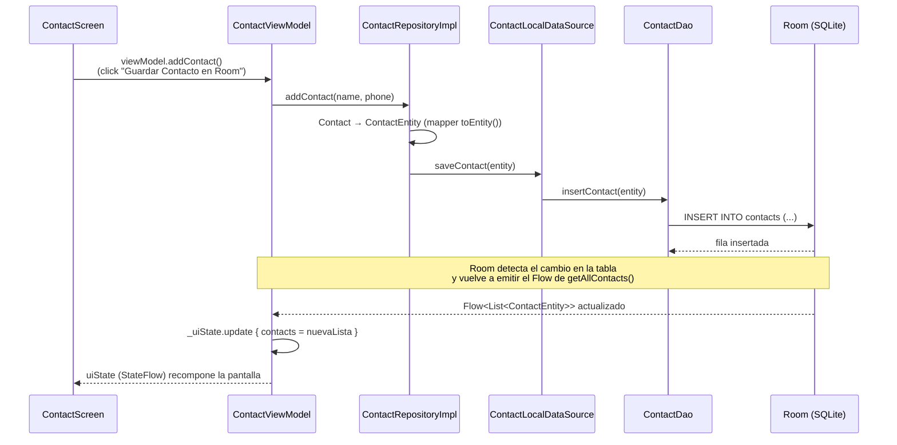
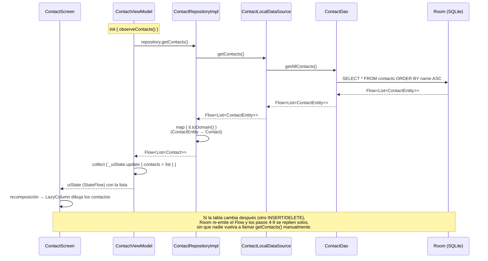

# Guía Paso a Paso: Implementación de Room, Retrofit y Hilt (Directorio Telefónico)

Esta guía tutorial explica paso a paso cómo construir una aplicación de **Listado Telefónico** en Android utilizando las mejores prácticas recomendadas por Google: **Clean Architecture**, **MVVM**, **Room**, **Retrofit**, **Corrutinas / Flow**, **Jetpack Compose** e **Inyección de Dependencias con Hilt**.

---

## 📐 1. Arquitectura y Estructura del Proyecto

El flujo de datos sigue un patrón unireccional desacoplado:

```text
[Jetpack Compose UI] ◄──(StateFlow)── [ContactViewModel]
                                             │
                                     (ContactRepository)
                                       /           \
               (ContactLocalDataSource)             (ContactRemoteDataSource)
                       │                                    │
                  [Room DAO]                         [Retrofit API]
                       │                                    │
                 (SQLite DB)                          (Servidor REST)
```

### ¿Por qué esta arquitectura?

Separar el proyecto en capas (`domain`, `data`, `ui`, `di`) no es una formalidad: cada capa resuelve un problema concreto y, al aislarlas, un cambio en una no obliga a tocar las demás.

- **`domain`**: es el "centro" de la app. Define *qué* es un contacto y *qué* se puede hacer con él, sin saber si los datos vienen de SQLite, de una API o de un archivo. Así, si mañana cambias Room por otra base de datos, esta capa no se entera.
- **`data`**: es el "cómo". Sabe hablar con Room (`local`) y con Retrofit (`remote`), y sabe traducir esos formatos técnicos al modelo de dominio (`mapper`). El `repository` de esta capa es quien decide, en la práctica, de dónde sale la información que ve el usuario.
- **`ui`**: es la "cara visible". Solo le importa mostrar datos y reaccionar a acciones del usuario (escribir, tocar un botón). No sabe ni le importa si detrás hay Room, Retrofit o ambos.
- **`di`**: es el "pegamento". Como cada capa depende de interfaces (no de implementaciones concretas) para no acoplarse, algo tiene que decidir *qué implementación real* se usa en cada caso; eso lo hace Hilt a través de estos módulos.

El flujo de datos es unidireccional: la UI nunca escribe directamente en la base de datos ni llama a la API; todo pasa por el ViewModel → Repository → (Room y/o Retrofit). Esto hace que, sin importar de dónde vengan los datos, la UI siempre reciba la misma forma de información (`Flow<List<Contact>>`) y se actualice sola cuando esos datos cambian.

La estructura de paquetes sugerida en `com.rojas.consumodatos` es:

```text
com.rojas.consumodatos/
 ├── domain/
 │    ├── model/Contact.kt                  # Modelo de Dominio
 │    └── repository/ContactRepository.kt    # Interfaz del Repositorio
 ├── data/
 │    ├── local/
 │    │    ├── ContactEntity.kt            # Entidad Room (Tabla 'contacts')
 │    │    ├── ContactDao.kt               # DAO con Consultas SQL
 │    │    ├── AppDatabase.kt              # RoomDatabase
 │    │    └── ContactLocalDataSource.kt   # Fuente de Datos Local
 │    ├── remote/
 │    │    ├── ContactDto.kt               # Data Transfer Object (JSON)
 │    │    ├── ContactApiService.kt        # Interfaz Retrofit
 │    │    └── ContactRemoteDataSource.kt  # Fuente de Datos Remota
 │    ├── mapper/
 │    │    └── ContactMapper.kt            # Mapeadores DTO <-> Entity <-> Domain
 │    └── repository/
 │         └── ContactRepositoryImpl.kt    # Implementación del Repositorio
 ├── di/
 │    ├── DatabaseModule.kt               # Proveedor Hilt para Room
 │    ├── NetworkModule.kt                # Proveedor Hilt para Retrofit
 │    └── RepositoryModule.kt             # Vinculación Hilt para Repositorio
 └── ui/
      └── contact/
           ├── ContactUiState.kt           # Estado inmutable de la UI
           ├── ContactViewModel.kt         # ViewModel
           └── ContactScreen.kt            # Vista Compose (Formulario y Lista)
```

---

## 📝 2. Paso 1: Modelo de Dominio (`domain/model/Contact.kt`)

**¿Por qué existe este archivo?** Porque Room necesita anotaciones (`@Entity`, `@PrimaryKey`) y Retrofit/Gson necesitan las suyas (`@SerializedName`), pero el resto de la app (ViewModel, UI) no debería depender de ninguna de esas librerías. `Contact` es la representación "neutral" del concepto de negocio: un contacto tiene `id`, `name` y `phone`, punto. Es el tipo que viaja por `domain/repository`, `ViewModel` y `Screen`.

**Qué sentido tiene crearlo:** si en el futuro cambias Room por otra librería de persistencia, o Retrofit por otro cliente HTTP, esta clase no cambia, y por lo tanto el ViewModel y la UI tampoco. Es el desacople entre "cómo se guardan/transportan los datos" y "qué son los datos para el negocio".

Crea la clase de modelo de dominio pura. Esta clase no tiene anotaciones de Room ni de Retrofit:

```kotlin
package com.rojas.consumodatos.domain.model

data class Contact(
    val id: Long = 0,
    val name: String,
    val phone: String
)
```

---

## 💾 3. Paso 2: Capa Local con Room (`data/local`)

Esta subcarpeta concentra todo lo que sabe hablar con **SQLite a través de Room**: la tabla (`ContactEntity`), las consultas (`ContactDao`), el contenedor de la base de datos (`AppDatabase`) y una capa fina que oculta el DAO al resto de la app (`ContactLocalDataSource`). Nada fuera de `data/local` debería importar clases de Room directamente.

### A. Entidad Room (`ContactEntity.kt`)
**Por qué existe:** Room necesita una clase anotada para saber cómo crear y leer la tabla SQL. `@Entity(tableName = "contacts")` le dice "crea una tabla llamada `contacts`" y cada propiedad se vuelve una columna. `@PrimaryKey(autoGenerate = true)` delega en SQLite la generación del `id`, para no tener que inventarlo a mano.

**Por qué no es lo mismo que `Contact` (domain):** porque si mañana cambias un detalle de la tabla (por ejemplo, agregar una columna interna de auditoría), no quieres que ese detalle "se filtre" al resto de la app. `ContactEntity` es la representación de la fila en SQLite; `Contact` es el concepto de negocio.

Representa la estructura de la tabla `contacts` en SQLite:

```kotlin
package com.rojas.consumodatos.data.local

import androidx.room.Entity
import androidx.room.PrimaryKey

@Entity(tableName = "contacts")
data class ContactEntity(
    @PrimaryKey(autoGenerate = true)
    val id: Long = 0,
    val name: String,
    val phone: String
)
```

### B. Interface DAO (`ContactDao.kt`)
**Por qué existe:** el DAO (*Data Access Object*) es el único lugar del proyecto donde se escribe SQL. Room genera automáticamente la implementación de esta interfaz a partir de las anotaciones (`@Query`, `@Insert`, `@Query` para `DELETE`), así que nunca escribes el código que ejecuta esas consultas, solo la firma.

**Qué sentido tiene:** que `getAllContacts()` devuelva `Flow<List<ContactEntity>>` (en vez de una lista simple) significa que Room **emite un nuevo valor automáticamente cada vez que la tabla cambia**. Eso es lo que permite que, más adelante, el ViewModel "escuche" la tabla y la UI se actualice sola sin tener que refrescar manualmente.

**¿Qué es `Flow` exactamente?** Es un flujo de datos asíncrono de Kotlin: en vez de pedir un valor una sola vez (como hace una función `suspend fun getContacts(): List<Contact>`), un `Flow` representa **una secuencia de valores en el tiempo** a la que alguien se "suscribe" con `.collect { ... }`. Pensarlo como una especie de "radio" al que te sintonizas: no pides un dato puntual, sino que te quedas escuchando y te avisan cada vez que hay uno nuevo.

Aplicado a `getAllContacts(): Flow<List<ContactEntity>>`:
- Es un flujo **frío** (*cold*): no hace nada hasta que alguien lo colecciona (en este proyecto, el `ContactViewModel` en `observeContacts()`).
- Room se encarga de **emitir una nueva lista completa cada vez que la tabla `contacts` cambia** (un `INSERT` o `DELETE`), sin que nadie tenga que pedirlo explícitamente ni volver a ejecutar la consulta a mano.
- Se cancela solo: cuando el que está coleccionando desaparece (por ejemplo, la pantalla se cierra y `viewModelScope` se cancela), Room deja de emitir y libera los recursos.
- Es la base de que toda la cadena Room → Repository → ViewModel → Compose sea **reactiva**: un cambio en SQLite se propaga solo hasta la UI, sin botones de "refrescar" ni *polling*.

Define las operaciones de base de datos. Retorna `Flow` para observación reactiva:

```kotlin
package com.rojas.consumodatos.data.local

import androidx.room.Dao
import androidx.room.Insert
import androidx.room.OnConflictStrategy
import androidx.room.Query
import kotlinx.coroutines.flow.Flow

@Dao
interface ContactDao {
    @Query("SELECT * FROM contacts ORDER BY name ASC")
    fun getAllContacts(): Flow<List<ContactEntity>>

    @Insert(onConflict = OnConflictStrategy.REPLACE)
    suspend fun insertContact(contact: ContactEntity)

    @Insert(onConflict = OnConflictStrategy.REPLACE)
    suspend fun insertContacts(contacts: List<ContactEntity>)

    @Query("DELETE FROM contacts WHERE id = :id")
    suspend fun deleteContactById(id: Long)
}
```

### C. Base de Datos Room (`AppDatabase.kt`)
**Por qué existe:** es el punto único de acceso a la base de datos física. `@Database(entities = [...], version = 1)` le dice a Room qué tablas debe crear y en qué versión de esquema está la base; `abstract fun contactDao()` expone el DAO para que Hilt pueda inyectarlo en otros lugares. Solo debe existir **una instancia** de esta clase en toda la app (por eso más adelante se inyecta como `@Singleton`).

```kotlin
package com.rojas.consumodatos.data.local

import androidx.room.Database
import androidx.room.RoomDatabase

@Database(entities = [ContactEntity::class], version = 1, exportSchema = false)
abstract class AppDatabase : RoomDatabase() {
    abstract fun contactDao(): ContactDao
}
```

### D. Fuente de Datos Local (`ContactLocalDataSource.kt`)
**¿Por qué existe si ya tenemos el DAO?** Esta es la pregunta obligada, porque en este proyecto `ContactLocalDataSourceImpl` solo **delega 1:1** cada método al `ContactDao` — no agrega ninguna lógica propia. La razón de que exista igual no es técnica sino de **desacoplamiento de capas**:

- El `ContactDao` es una interfaz de **Room**: sus tipos, anotaciones (`@Dao`, `@Query`, `@Insert`) y semántica solo tienen sentido porque Room las entiende. Si el `Repository` inyectara el DAO directamente, quedaría atado a Room.
- El `ContactLocalDataSource` es una interfaz **neutral**: dice "la fuente de datos local sabe `getContacts()`, `saveContact()`, etc.", sin mencionar Room para nada. La implementación (`ContactLocalDataSourceImpl`) es la *única* clase que conoce al DAO; todo lo demás (Repository, ViewModel, UI) ni se entera de que existe.
- En pruebas, se puede reemplazar `ContactLocalDataSource` por una implementación falsa sin tocar Room ni el dispositivo, al testear el Repository o el ViewModel de forma aislada.
- Si el día de mañana cambias Room por otra librería de persistencia, o agregas una segunda fuente local (por ejemplo, un cache en memoria), el cambio queda contenido en esta capa: el Repository no se entera.

**Siendo honestos:** en un proyecto de este tamaño, con un solo DAO y sin planes de cambiar de librería, esta capa hoy es principalmente *boilerplate* — no evita ningún bug ni agrega comportamiento. Es una decisión de **Clean Architecture por consistencia y escalabilidad a futuro**, no una necesidad técnica inmediata. Si el proyecto fuera a quedarse siempre así de simple, se podría inyectar el `ContactDao` directamente en el Repository sin perder nada hoy; la ventaja de mantener el `DataSource` aparece recién cuando el proyecto crece (más fuentes de datos, más pruebas, cambios de librería).

Abstrae las llamadas directas al DAO:

```kotlin
package com.rojas.consumodatos.data.local

import kotlinx.coroutines.flow.Flow
import javax.inject.Inject

interface ContactLocalDataSource {
    fun getContacts(): Flow<List<ContactEntity>>
    suspend fun saveContact(contact: ContactEntity)
    suspend fun saveContacts(contacts: List<ContactEntity>)
    suspend fun deleteContact(id: Long)
}

class ContactLocalDataSourceImpl @Inject constructor(
    private val contactDao: ContactDao
) : ContactLocalDataSource {
    override fun getContacts(): Flow<List<ContactEntity>> = contactDao.getAllContacts()
    override suspend fun saveContact(contact: ContactEntity) = contactDao.insertContact(contact)
    override suspend fun saveContacts(contacts: List<ContactEntity>) = contactDao.insertContacts(contacts)
    override suspend fun deleteContact(id: Long) = contactDao.deleteContactById(id)
}
```

---

## 🌐 4. Paso 3: Capa Remota con Retrofit y OkHttp (`data/remote`)

Igual que `data/local` concentra todo lo relacionado a Room, `data/remote` concentra todo lo relacionado a hablar con el servidor REST: el formato del JSON (`ContactDto`), el contrato HTTP (`ContactApiService`) y una capa fina que lo esconde del resto de la app (`ContactRemoteDataSource`).

### A. DTO Red (`ContactDto.kt`)
**Por qué existe:** un DTO (*Data Transfer Object*) representa el JSON tal cual lo entrega o espera la API, que casi nunca coincide 1:1 con el modelo de dominio (nombres de campo distintos, campos opcionales, campos que la app ignora). `@SerializedName` le dice a Gson cómo mapear cada campo del JSON a esta clase.

**Por qué no reutilizar `Contact` directamente:** porque si la API cambia el nombre de un campo o agrega uno nuevo, no quieres que ese cambio obligue a tocar el ViewModel o la UI. El DTO absorbe esos cambios; el dominio queda intacto.
```kotlin
package com.rojas.consumodatos.data.remote

import com.google.gson.annotations.SerializedName

data class ContactDto(
    @SerializedName("id") val id: Long? = null,
    @SerializedName("name") val name: String,
    @SerializedName("phone") val phone: String
)
```

### B. Servicio API Retrofit (`ContactApiService.kt`)
**Por qué existe:** es el contrato HTTP declarado como interfaz; Retrofit genera la implementación real (las llamadas de red) a partir de las anotaciones (`@GET`, `@POST`, `@Body`). Así nunca escribes a mano el código que arma la petición HTTP, solo describes el endpoint.
```kotlin
package com.rojas.consumodatos.data.remote

import retrofit2.http.Body
import retrofit2.http.GET
import retrofit2.http.POST

interface ContactApiService {
    @GET("contacts")
    suspend fun getContacts(): List<ContactDto>

    @POST("contacts")
    suspend fun createContact(@Body contact: ContactDto): ContactDto
}
```

### C. Fuente de Datos Remota (`ContactRemoteDataSource.kt`)
**Por qué existe:** mismo motivo que `ContactLocalDataSource`, pero para la red: el `Repository` depende de la interfaz `ContactRemoteDataSource` ("la fuente de datos remota"), no de Retrofit directamente. Esto permite, por ejemplo, reemplazar Retrofit por otro cliente HTTP sin tocar el repositorio, o simularla en pruebas.
```kotlin
package com.rojas.consumodatos.data.remote

import javax.inject.Inject

interface ContactRemoteDataSource {
    suspend fun fetchContacts(): List<ContactDto>
    suspend fun addContact(contact: ContactDto): ContactDto
}

class ContactRemoteDataSourceImpl @Inject constructor(
    private val apiService: ContactApiService
) : ContactRemoteDataSource {
    override suspend fun fetchContacts(): List<ContactDto> = apiService.getContacts()
    override suspend fun addContact(contact: ContactDto): ContactDto = apiService.createContact(contact)
}
```

---

## 🔄 5. Paso 4: Mapeadores de Datos (`data/mapper/ContactMapper.kt`)

**Por qué existe:** ahora hay tres representaciones del mismo "contacto" (`ContactEntity` para Room, `ContactDto` para la red, `Contact` para el resto de la app) y alguien tiene que traducir entre ellas. Si esa traducción se hiciera dentro del DAO, del ApiService o del ViewModel, cada capa terminaría conociendo los detalles de las otras, rompiendo el desacople que se buscó al separarlas.

**Qué sentido tiene:** al ser funciones de extensión puras (`ContactEntity.toDomain()`, `Contact.toEntity()`, etc.), son fáciles de testear de forma aislada y concentran en un solo archivo toda la lógica de conversión. El `Repository` es el único que las usa.

Funciones de extensión para convertir modelos entre capas sin acoplarlas:

```kotlin
package com.rojas.consumodatos.data.mapper

import com.rojas.consumodatos.data.local.ContactEntity
import com.rojas.consumodatos.data.remote.ContactDto
import com.rojas.consumodatos.domain.model.Contact

fun ContactEntity.toDomain() = Contact(id = id, name = name, phone = phone)
fun Contact.toEntity() = ContactEntity(id = id, name = name, phone = phone)
fun ContactDto.toEntity() = ContactEntity(id = id ?: 0, name = name, phone = phone)
fun Contact.toDto() = ContactDto(id = if (id == 0L) null else id, name = name, phone = phone)
```

---

## 🏢 6. Paso 5: Capa Repositorio (`domain/repository` y `data/repository`)

El Repositorio es la pieza que decide, en la práctica, **de dónde viene la verdad**: aquí viven las reglas como "la UI siempre lee de Room" y "la red solo se usa para sincronizar/escribir", combinando `ContactLocalDataSource` y `ContactRemoteDataSource` detrás de una única API simple para el resto de la app (el patrón *Single Source of Truth*).

### A. Interfaz del Repositorio (`domain/repository/ContactRepository.kt`)
**Por qué está en `domain` y no en `data`:** porque el ViewModel (capa de presentación) solo debería depender de *qué* operaciones de negocio existen (`getContacts`, `addContact`, `syncRemoteContacts`, `deleteContact`), no de *cómo* están implementadas. Al vivir la interfaz en `domain`, el ViewModel puede ignorar por completo que detrás hay Room y Retrofit.
```kotlin
package com.rojas.consumodatos.domain.repository

import com.rojas.consumodatos.domain.model.Contact
import kotlinx.coroutines.flow.Flow

interface ContactRepository {
    fun getContacts(): Flow<List<Contact>>
    suspend fun addContact(name: String, phone: String)
    suspend fun syncRemoteContacts()
    suspend fun deleteContact(id: Long)
}
```

### B. Implementación (`data/repository/ContactRepositoryImpl.kt`)
**Cómo interactúa con las capas anteriores:** recibe por constructor (inyectadas por Hilt) las dos fuentes de datos. `getContacts()` siempre lee de `localDataSource` y la convierte con el mapper — por eso la UI "ve" los datos de SQLite, no los de la red directamente. `syncRemoteContacts()` es la única operación que toca la red: descarga los contactos remotos y los **guarda en Room**; la UI se entera de ese cambio automáticamente porque sigue observando el mismo `Flow` de la base de datos local. Así, Room actúa como caché/fuente única y la red solo "alimenta" esa caché.

```kotlin
package com.rojas.consumodatos.data.repository

import com.rojas.consumodatos.data.local.ContactLocalDataSource
import com.rojas.consumodatos.data.mapper.toDomain
import com.rojas.consumodatos.data.mapper.toEntity
import com.rojas.consumodatos.data.remote.ContactRemoteDataSource
import com.rojas.consumodatos.domain.model.Contact
import com.rojas.consumodatos.domain.repository.ContactRepository
import kotlinx.coroutines.flow.Flow
import kotlinx.coroutines.flow.map
import javax.inject.Inject

class ContactRepositoryImpl @Inject constructor(
    private val localDataSource: ContactLocalDataSource,
    private val remoteDataSource: ContactRemoteDataSource
) : ContactRepository {

    override fun getContacts(): Flow<List<Contact>> {
        return localDataSource.getContacts().map { entities ->
            entities.map { it.toDomain() }
        }
    }

    override suspend fun addContact(name: String, phone: String) {
        val contact = Contact(name = name, phone = phone)
        localDataSource.saveContact(contact.toEntity())
    }

    override suspend fun syncRemoteContacts() {
        runCatching {
            val remoteDtos = remoteDataSource.fetchContacts()
            val entities = remoteDtos.map { it.toEntity() }
            localDataSource.saveContacts(entities)
        }
    }

    override suspend fun deleteContact(id: Long) {
        localDataSource.deleteContact(id)
    }
}
```

---

## 💉 7. Paso 6: Inversión e Inyección de Dependencias (`di`)

Hasta aquí, casi todas las clases dependen de **interfaces** (`ContactLocalDataSource`, `ContactRemoteDataSource`, `ContactRepository`) y no de implementaciones concretas. Eso es intencional (Inversión de Dependencias), pero en algún lugar hay que decirle al sistema **qué implementación real usar** cuando algo pide, por ejemplo, un `ContactRepository`. Ese "algún lugar" son los módulos de Hilt en `di`: cada uno agrupa las dependencias de un área (base de datos, red, repositorios) y Hilt arma automáticamente el grafo de objetos, evitando que cada clase tenga que crear sus propias dependencias a mano (`new`/constructores manuales por todos lados).

### ¿Qué hace `@Module`?

`@Module` es la anotación que le dice a Hilt/Dagger: **"esta clase (u `object`/`interface`) es una receta de cómo construir ciertas dependencias"**. Por sí sola no hace nada; siempre va acompañada de:

- **`@InstallIn(SingletonComponent::class)`**: le dice a Hilt **en qué "contenedor" vive** lo que provee este módulo. `SingletonComponent` significa "vive mientras viva la aplicación completa" — por eso las instancias que salen de aquí pueden marcarse `@Singleton` (una sola, compartida por toda la app). Hilt tiene otros componentes para ámbitos más acotados (por Activity, por ViewModel, etc.), pero en este proyecto todo lo que se inyecta es a nivel de toda la app.
- **Dentro del módulo, cada función resuelve "cómo construir un tipo":**
  - `@Provides` (usado en `DatabaseModule` y `NetworkModule`, que son `object`): para cuando la dependencia **no se puede construir con un simple constructor inyectable** — por ejemplo, `AppDatabase` se arma llamando a `Room.databaseBuilder(...)`, que no es un `@Inject constructor`. Aquí escribes a mano la lógica de construcción, una sola vez, y Hilt reutiliza el resultado cada vez que algo pide ese tipo.
  - `@Binds` (usado en `RepositoryModule`, que es una `interface` abstracta): para cuando solo hay que decir "cuando pidan la interfaz `ContactRepository`, entrega una instancia de `ContactRepositoryImpl`" — una asociación directa interfaz→implementación, sin lógica de construcción. Es más liviano que `@Provides` porque Dagger no tiene que ejecutar código, solo "conectar" el tipo pedido con el tipo concreto (que a su vez ya sabe construirse solo gracias a su `@Inject constructor`).

**En resumen:** sin `@Module` (+ `@InstallIn`), Hilt no tendría ningún lugar donde buscar "cómo se construye un `AppDatabase`, un `OkHttpClient` o un `ContactRepository`" — y la inyección en los `ViewModel` (`@Inject constructor`) fallaría en tiempo de compilación porque faltaría una pieza del grafo de dependencias.

### A. Módulo de Base de Datos (`DatabaseModule.kt`)
**Qué resuelve:** cómo se construye la única instancia de `AppDatabase` (`Room.databaseBuilder(...)`, marcada `@Singleton` para que sea una sola en toda la app) y cómo se obtienen el `ContactDao` y el `ContactLocalDataSource` a partir de ella. Sin este módulo, Hilt no sabría cómo crear un `AppDatabase` cuando alguna clase lo pide en su constructor.
```kotlin
package com.rojas.consumodatos.di

import android.content.Context
import androidx.room.Room
import com.rojas.consumodatos.data.local.AppDatabase
import com.rojas.consumodatos.data.local.ContactDao
import com.rojas.consumodatos.data.local.ContactLocalDataSource
import com.rojas.consumodatos.data.local.ContactLocalDataSourceImpl
import dagger.Module
import dagger.Provides
import dagger.hilt.InstallIn
import dagger.hilt.android.qualifiers.ApplicationContext
import dagger.hilt.components.SingletonComponent
import javax.inject.Singleton

@Module
@InstallIn(SingletonComponent::class)
object DatabaseModule {

    @Provides
    @Singleton
    fun provideAppDatabase(@ApplicationContext context: Context): AppDatabase {
        return Room.databaseBuilder(
            context,
            AppDatabase::class.java,
            "contacts_db"
        ).fallbackToDestructiveMigration().build()
    }

    @Provides
    fun provideContactDao(db: AppDatabase): ContactDao = db.contactDao()

    @Provides
    @Singleton
    fun provideContactLocalDataSource(impl: ContactLocalDataSourceImpl): ContactLocalDataSource = impl
}
```

### B. Módulo de Red (`NetworkModule.kt`)
**Qué resuelve:** cómo se arma el cliente HTTP (`OkHttpClient`, con el interceptor de logging para ver las peticiones en el Logcat durante desarrollo) y cómo se construye el `Retrofit`/`ContactApiService` a partir de él (URL base, convertidor JSON). Centraliza en un solo lugar la configuración de red, en vez de repetirla cada vez que se necesita hacer una llamada HTTP.
```kotlin
package com.rojas.consumodatos.di

import com.rojas.consumodatos.data.remote.ContactApiService
import com.rojas.consumodatos.data.remote.ContactRemoteDataSource
import com.rojas.consumodatos.data.remote.ContactRemoteDataSourceImpl
import dagger.Module
import dagger.Provides
import dagger.hilt.InstallIn
import dagger.hilt.components.SingletonComponent
import okhttp3.OkHttpClient
import okhttp3.logging.HttpLoggingInterceptor
import retrofit2.Retrofit
import retrofit2.converter.gson.GsonConverterFactory
import javax.inject.Singleton

@Module
@InstallIn(SingletonComponent::class)
object NetworkModule {

    @Provides
    @Singleton
    fun provideOkHttpClient(): OkHttpClient {
        return OkHttpClient.Builder()
            .addInterceptor(HttpLoggingInterceptor().apply {
                level = HttpLoggingInterceptor.Level.BODY
            })
            .build()
    }

    @Provides
    @Singleton
    fun provideContactApiService(okHttpClient: OkHttpClient): ContactApiService {
        return Retrofit.Builder()
            .baseUrl("https://jsonplaceholder.typicode.com/")
            .client(okHttpClient)
            .addConverterFactory(GsonConverterFactory.create())
            .build()
            .create(ContactApiService::class.java)
    }

    @Provides
    @Singleton
    fun provideContactRemoteDataSource(impl: ContactRemoteDataSourceImpl): ContactRemoteDataSource = impl
}
```

### C. Módulo de Repositorio (`RepositoryModule.kt`)
**Qué resuelve:** la "conexión" entre la interfaz `ContactRepository` (de `domain`) y su implementación `ContactRepositoryImpl` (de `data`). Usa `@Binds` en vez de `@Provides` porque es una asociación directa interfaz→implementación (más eficiente para Hilt que construir el objeto manualmente). Gracias a este módulo, cuando el `ContactViewModel` pide un `ContactRepository` en su constructor, Hilt sabe que debe entregarle una instancia de `ContactRepositoryImpl` ya armada con sus propias dependencias (las fuentes de datos local y remota).
```kotlin
package com.rojas.consumodatos.di

import com.rojas.consumodatos.data.repository.ContactRepositoryImpl
import com.rojas.consumodatos.domain.repository.ContactRepository
import dagger.Binds
import dagger.Module
import dagger.hilt.InstallIn
import dagger.hilt.components.SingletonComponent
import javax.inject.Singleton

@Module
@InstallIn(SingletonComponent::class)
interface RepositoryModule {

    @Binds
    @Singleton
    fun bindContactRepository(
        impl: ContactRepositoryImpl
    ): ContactRepository
}
```

---

## 📱 8. Paso 7: Capa de Presentación (`ui/contact`)

Esta capa implementa **MVVM**: el `ContactViewModel` expone un único estado observable (`ContactUiState`) que la `ContactScreen` solo lee y dibuja; la pantalla nunca decide por su cuenta qué mostrar, solo reacciona al estado actual. Toda interacción del usuario (escribir un nombre, tocar "Guardar") se traduce en una llamada a una función del ViewModel, nunca en lógica dentro de la propia pantalla.

### A. Estado de la UI (`ContactUiState.kt`)
**Por qué existe:** en vez de que la `Screen` maneje varias variables sueltas (lista, texto del input, si está cargando, si hay error), todo el estado visual se agrupa en **una sola clase inmutable**. Esto hace imposible que la UI quede en un estado inconsistente a medias, y hace trivial ver, de un vistazo, todo lo que la pantalla puede mostrar.
```kotlin
package com.rojas.consumodatos.ui.contact

import com.rojas.consumodatos.domain.model.Contact

data class ContactUiState(
    val contacts: List<Contact> = emptyList(),
    val nameInput: String = "",
    val phoneInput: String = "",
    val isLoading: Boolean = false,
    val errorMessage: String? = null
)
```

### B. ViewModel (`ContactViewModel.kt`)
**Por qué existe y cómo interactúa:** el ViewModel es el puente entre la UI y el `ContactRepository`. En `init`/`observeContacts()` se suscribe al `Flow` del repositorio y, cada vez que Room emite una nueva lista, actualiza `_uiState` — eso es lo que hace que la lista en pantalla se refresque sola sin que nadie llame a un "refrescar" manual. `addContact()` y `deleteContact()` delegan en el repositorio y sobreviven a rotaciones de pantalla gracias a `viewModelScope`. `@HiltViewModel` le dice a Hilt que puede inyectar el `ContactRepository` automáticamente al construirlo.

**Por qué `MutableStateFlow`/`StateFlow` separados:** `_uiState` (mutable, privado) es lo único que el ViewModel puede modificar; `uiState` (de solo lectura, público) es lo único que la `Screen` puede observar. Así se evita que la UI "tramposeé" y cambie el estado sin pasar por la lógica del ViewModel.

**Línea por línea: `observeContacts()`**

```kotlin
private fun observeContacts() {
    viewModelScope.launch {
        _uiState.update { it.copy(isLoading = true) }
        repository.getContacts()
            .catch { e ->
                _uiState.update { it.copy(isLoading = false, errorMessage = e.message) }
            }
            .collect { list ->
                _uiState.update { it.copy(contacts = list, isLoading = false) }
            }
    }
}
```

- **`viewModelScope.launch { ... }`**: `collect` es una función `suspend` — no puede llamarse "a secas" en Kotlin, necesita correr dentro de una corrutina. `viewModelScope` es un `CoroutineScope` que Android liga automáticamente al ciclo de vida del ViewModel: cuando el ViewModel se destruye (por ejemplo, la pantalla se cierra para siempre), esta corrutina se cancela sola y deja de escuchar el `Flow`, sin fugas de memoria.
- **`_uiState.update { it.copy(isLoading = true) }`** (antes de suscribirse): deja la UI en estado "cargando" apenas arranca el ViewModel, antes incluso de que Room entregue el primer valor. `it.copy(...)` crea una copia del `ContactUiState` actual cambiando solo `isLoading`, sin tocar los demás campos (`contacts`, `nameInput`, etc.) — así nunca se pisa información que no corresponde cambiar en ese punto.
- **`repository.getContacts()`**: obtiene el `Flow<List<Contact>>` del repositorio. Hasta aquí **todavía no pasa nada**: un `Flow` es "frío", no emite valores hasta que alguien lo colecciona (ver más abajo). Esta línea solo arma la "cañería", no abre la llave.
- **`.catch { e -> ... }`**: es el manejo de errores del `Flow`. Si en cualquier punto de la cadena (Room, el mapper, etc.) se lanza una excepción, en vez de **crashear la app**, `catch` la intercepta y permite reaccionar: aquí se apaga el loading y se guarda `e.message` en `errorMessage` para que la UI pueda mostrarlo. Importante: `catch` solo atrapa errores que ocurren **antes** de él en la cadena (en el `Flow` del repositorio), nunca los que ocurran dentro del propio `collect`.
- **`.collect { list -> ... }`**: es el punto donde el `Flow` finalmente "se abre": llamar a `collect` es lo que le dice a Room "empieza a emitirme valores". A partir de aquí, esta lambda se ejecuta **cada vez** que la tabla `contacts` cambia (no una sola vez): la primera vez con la lista inicial, y después con cada lista nueva tras un `INSERT`/`DELETE`. Por eso `collect` nunca "retorna": la corrutina se queda suspendida aquí, escuchando, mientras el `viewModelScope` siga vivo.
- **`_uiState.update { it.copy(contacts = list, isLoading = false) }`**: cada vez que llega una lista nueva, reemplaza `contacts` en el estado y apaga el loading. Como `uiState` es un `StateFlow` que la `Screen` observa con `collectAsStateWithLifecycle()`, este `update` es lo único que hace falta para que la lista en pantalla se redibuje — nadie llama a la UI directamente, la UI reacciona sola al cambio de estado.

```kotlin
package com.rojas.consumodatos.ui.contact

import androidx.lifecycle.ViewModel
import androidx.lifecycle.viewModelScope
import com.rojas.consumodatos.domain.repository.ContactRepository
import dagger.hilt.android.lifecycle.HiltViewModel
import kotlinx.coroutines.flow.MutableStateFlow
import kotlinx.coroutines.flow.StateFlow
import kotlinx.coroutines.flow.asStateFlow
import kotlinx.coroutines.flow.catch
import kotlinx.coroutines.flow.update
import kotlinx.coroutines.launch
import javax.inject.Inject

@HiltViewModel
class ContactViewModel @Inject constructor(
    private val repository: ContactRepository
) : ViewModel() {

    private val _uiState = MutableStateFlow(ContactUiState())
    val uiState: StateFlow<ContactUiState> = _uiState.asStateFlow()

    init {
        observeContacts()
    }

    private fun observeContacts() {
        viewModelScope.launch {
            _uiState.update { it.copy(isLoading = true) }
            repository.getContacts()
                .catch { e ->
                    _uiState.update { it.copy(isLoading = false, errorMessage = e.message) }
                }
                .collect { list ->
                    _uiState.update { it.copy(contacts = list, isLoading = false) }
                }
        }
    }

    fun onNameChanged(name: String) {
        _uiState.update { it.copy(nameInput = name) }
    }

    fun onPhoneChanged(phone: String) {
        _uiState.update { it.copy(phoneInput = phone) }
    }

    fun addContact() {
        val name = _uiState.value.nameInput.trim()
        val phone = _uiState.value.phoneInput.trim()

        if (name.isBlank() || phone.isBlank()) return

        viewModelScope.launch {
            repository.addContact(name, phone)
            _uiState.update { it.copy(nameInput = "", phoneInput = "") }
        }
    }

    fun deleteContact(id: Long) {
        viewModelScope.launch {
            repository.deleteContact(id)
        }
    }
}
```

### C. Vista en Jetpack Compose (`ContactScreen.kt`)
**Por qué existe y cómo interactúa:** es la única clase que "sabe dibujar" la pantalla. Lee `uiState` con `collectAsStateWithLifecycle()` (que se desuscribe automáticamente cuando la pantalla no está visible, evitando fugas de memoria) y, por cada campo de `ContactUiState`, decide qué mostrar (carga, lista vacía, lista de contactos). Cada acción del usuario (`onValueChange`, `onClick`) llama directamente a una función del `viewModel` (`viewModel::onNameChanged`, `viewModel::addContact`) — la pantalla no contiene ninguna regla de negocio, solo layout y delegación.

```kotlin
package com.rojas.consumodatos.ui.contact

import androidx.compose.foundation.layout.*
import androidx.compose.foundation.lazy.LazyColumn
import androidx.compose.foundation.lazy.items
import androidx.compose.material3.*
import androidx.compose.runtime.Composable
import androidx.compose.runtime.getValue
import androidx.compose.ui.Alignment
import androidx.compose.ui.Modifier
import androidx.compose.ui.unit.dp
import androidx.lifecycle.compose.collectAsStateWithLifecycle

@Composable
fun ContactScreen(
    viewModel: ContactViewModel,
    modifier: Modifier = Modifier
) {
    val uiState by viewModel.uiState.collectAsStateWithLifecycle()

    Column(
        modifier = modifier
            .fillMaxSize()
            .padding(16.dp)
    ) {
        Text(
            text = "Directorio Telefónico",
            style = MaterialTheme.typography.headlineMedium,
            modifier = Modifier.padding(bottom = 16.dp)
        )

        // Formulario de Ingreso
        OutlinedTextField(
            value = uiState.nameInput,
            onValueChange = viewModel::onNameChanged,
            label = { Text("Nombre") },
            modifier = Modifier.fillMaxWidth()
        )

        Spacer(modifier = Modifier.height(8.dp))

        OutlinedTextField(
            value = uiState.phoneInput,
            onValueChange = viewModel::onPhoneChanged,
            label = { Text("Teléfono") },
            modifier = Modifier.fillMaxWidth()
        )

        Spacer(modifier = Modifier.height(12.dp))

        Button(
            onClick = viewModel::addContact,
            modifier = Modifier.fillMaxWidth()
        ) {
            Text("Guardar Contacto en Room")
        }

        Spacer(modifier = Modifier.height(16.dp))

        // Lista de Contactos
        if (uiState.isLoading) {
            CircularProgressIndicator(modifier = Modifier.align(Alignment.CenterHorizontally))
        } else if (uiState.contacts.isEmpty()) {
            Text(
                text = "No hay contactos guardados.",
                style = MaterialTheme.typography.bodyLarge,
                modifier = Modifier.align(Alignment.CenterHorizontally)
            )
        } else {
            LazyColumn(
                verticalArrangement = Arrangement.spacedBy(8.dp),
                modifier = Modifier.fillMaxWidth()
            ) {
                items(uiState.contacts, key = { it.id }) { contact ->
                    Card(
                        modifier = Modifier.fillMaxWidth(),
                        elevation = CardDefaults.cardElevation(defaultElevation = 2.dp)
                    ) {
                        Row(
                            modifier = Modifier
                                .fillMaxWidth()
                                .padding(16.dp),
                            horizontalArrangement = Arrangement.SpaceBetween,
                            verticalAlignment = Alignment.CenterVertically
                        ) {
                            Column(modifier = Modifier.weight(1f)) {
                                Text(text = contact.name, style = MaterialTheme.typography.titleMedium)
                                Text(text = contact.phone, style = MaterialTheme.typography.bodyMedium)
                            }
                            TextButton(onClick = { viewModel.deleteContact(contact.id) }) {
                                Text("Eliminar", color = MaterialTheme.colorScheme.error)
                            }
                        }
                    }
                }
            }
        }
    }
}
```

---

## ⚡ 9. Paso 8: Inicialización y Punto de Entrada

Estos tres archivos son el "cableado" final que hace que todo lo anterior cobre vida al abrir la app.

### A. Application (`ConsumoDatosApp.kt`)
**Por qué existe:** Hilt necesita una clase `Application` anotada con `@HiltAndroidApp` para generar, en tiempo de compilación, el contenedor de dependencias raíz de toda la app (de donde salen las instancias `@Singleton` como `AppDatabase` o `ContactRepositoryImpl`). Sin esta clase, ningún `@Inject` ni `@HiltViewModel` del proyecto funcionaría.
```kotlin
package com.rojas.consumodatos

import android.app.Application
import dagger.hilt.android.HiltAndroidApp

@HiltAndroidApp
class ConsumoDatosApp : Application()
```

### B. Manifest (`AndroidManifest.xml`)
**Por qué existe:** el sistema operativo Android necesita saber, antes de arrancar cualquier pantalla, cuál es la clase `Application` de la app (`android:name=".ConsumoDatosApp"`). Si no se registra aquí, Android usaría la `Application` por defecto y el contenedor de Hilt nunca se crearía.

Registra la clase `ConsumoDatosApp`:
```xml
<application
    android:name=".ConsumoDatosApp"
    ... >
</application>
```

### C. Activity (`MainActivity.kt`)
**Por qué existe y cómo cierra el círculo:** es el punto de entrada visual: `@AndroidEntryPoint` habilita la inyección de Hilt dentro de la Activity (necesario para que `hiltViewModel()` funcione más abajo). `hiltViewModel()` le pide a Hilt un `ContactViewModel` ya construido con su `ContactRepository` inyectado, y ese ViewModel se lo pasa a `ContactScreen`. Con esto se cierra el círculo completo: `MainActivity` → crea/obtiene `ContactViewModel` → éste observa `ContactRepository` → que combina Room y Retrofit → y cualquier cambio en esa cadena termina re-dibujando `ContactScreen` automáticamente.

```kotlin
package com.rojas.consumodatos

import android.os.Bundle
import androidx.activity.ComponentActivity
import androidx.activity.compose.setContent
import androidx.activity.enableEdgeToEdge
import androidx.compose.foundation.layout.fillMaxSize
import androidx.compose.foundation.layout.padding
import androidx.compose.material3.Scaffold
import androidx.compose.ui.Modifier
import androidx.hilt.navigation.compose.hiltViewModel
import com.rojas.consumodatos.ui.contact.ContactScreen
import com.rojas.consumodatos.ui.theme.ConsumoDatosTheme
import dagger.hilt.android.AndroidEntryPoint

@AndroidEntryPoint
class MainActivity : ComponentActivity() {
    override fun onCreate(savedInstanceState: Bundle?) {
        super.onCreate(savedInstanceState)
        enableEdgeToEdge()
        setContent {
            ConsumoDatosTheme {
                Scaffold(modifier = Modifier.fillMaxSize()) { innerPadding ->
                    ContactScreen(
                        viewModel = hiltViewModel(),
                        modifier = Modifier.padding(innerPadding)
                    )
                }
            }
        }
    }
}
```

---

## 🔗 10. Cómo interactúan todas las capas juntas

Siguiendo el ejemplo de **agregar un contacto nuevo**, así recorre el sistema una sola acción del usuario, capa por capa:

1. El usuario escribe en los campos y toca **"Guardar Contacto en Room"** en `ContactScreen`. Esto llama a `viewModel::addContact` — la Screen no sabe nada de Room ni de reglas de negocio, solo delega.
2. `ContactViewModel.addContact()` valida que los campos no estén vacíos y llama a `repository.addContact(name, phone)`. El ViewModel no sabe si eso termina en SQLite, en un archivo o en la red: solo conoce la interfaz `ContactRepository`.
3. `ContactRepositoryImpl.addContact()` construye un `Contact` (modelo de dominio), lo convierte a `ContactEntity` con el mapper (`toEntity()`) y se lo pasa a `ContactLocalDataSource.saveContact(...)`.
4. `ContactLocalDataSourceImpl` delega en `ContactDao.insertContact(...)`, que es donde Room finalmente ejecuta el `INSERT` real en SQLite.
5. Como `ContactDao.getAllContacts()` devuelve un `Flow`, Room emite automáticamente la lista actualizada apenas se confirma el `INSERT`, sin que nadie se lo pida explícitamente.
6. `ContactViewModel`, que está coleccionando ese `Flow` desde `observeContacts()`, recibe la nueva lista y actualiza `_uiState`.
7. `ContactScreen`, que observa `uiState` con `collectAsStateWithLifecycle()`, se recompone automáticamente y muestra el nuevo contacto en la `LazyColumn`.

### Diagrama: del input a la base de datos (guardar)



Todo esto ocurre sin que ninguna capa conozca los detalles internos de la siguiente: la Screen no sabe de Room, el ViewModel no sabe de SQL, el Repository no sabe de Compose. Hilt (`di`) es quien, al arrancar la app, conecta todas las implementaciones concretas detrás de cada interfaz para que esta cadena exista en tiempo de ejecución.

El mismo patrón aplica para `syncRemoteContacts()`, solo que ahí el Repository primero llama a `ContactRemoteDataSource.fetchContacts()` (Retrofit → API) y guarda el resultado en `ContactLocalDataSource` — la UI sigue sin enterarse de que hubo una llamada de red: solo ve que, en algún momento, la tabla local cambió.

### Diagrama: de la base de datos de vuelta a la UI (cargar/`getAll`)

Este es el camino inverso: qué pasa cuando `ContactScreen` se abre por primera vez y necesita mostrar los contactos ya guardados.


